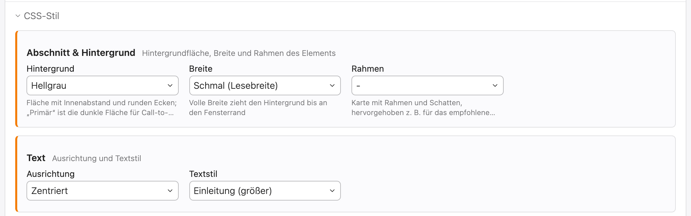

Contao CSS Style Selector Bundle
================================

This Contao extension lets you define CSS styles (a name plus one or more CSS
classes) once in the back end and select them in articles, content elements,
modules, forms, form fields, page layouts, pages, news and events. The classes
of the selected styles are written into the CSS class field of the record.

### CSS styles can be defined here


### The predefined styles can be selected here




Requirements
------------

- PHP 8.1 or higher (Contao 6 requires PHP 8.4)
- Contao 5.3 or higher, including Contao 6


Installation
------------

Install the bundle via the Contao Manager or Composer and update the database
afterwards:

```bash
composer require pdir/css-style-selector-bundle
vendor/bin/contao-console contao:migrate
```


Usage
-----

Go to *Layout → CSS styles*, create a group and add your styles to it.

**Groups**

- Each group is shown as its own section in the style selection.
- *Sorting* defines the order of the groups (lower values first). New groups
  are added at the end.
- *Description* is an optional hint for editors, shown below the group title.
- Without *Multiple selection*, editors can pick only one style per group
  (e.g. "Background: light / dark"), so conflicting classes are not possible.
- *Limit to user groups* offers the styles of a group to certain back end user
  groups only. Administrators always see all styles. Styles selected by other
  users are kept when an editor without access saves the record.

**Styles**

- **Description:** an optional short hint for editors, shown in the selection.
- **Preview:** an optional color and/or image, shown as a tile in the selection.
- **Sorting:** drag and drop the styles to define their order.
- **Permissions:** disable a style for whole areas, e.g. "Disable in pages".
- **Restrictions:** limit a style to certain content element, module or form
  field types (e.g. only for `text` and `image` elements). If a restriction is
  active, the style is only offered for the selected types.

**For editors**

The style selection is shown in its own "CSS style" section near the top of
the form. It is hidden if no styles are available for the record. The list
views show the selected styles next to each record.

The CSS class field only shows the classes you entered yourself. The classes
of the selected styles are added when the record is saved and are stored in
the CSS class field, so they work with every template. Classes that belong to
a style can only be set through the style selection.

**Updating from version 2.0**

Run `vendor/bin/contao-console contao:migrate`. Existing styles are moved into
the group "Styles", which allows multiple selection like before.
